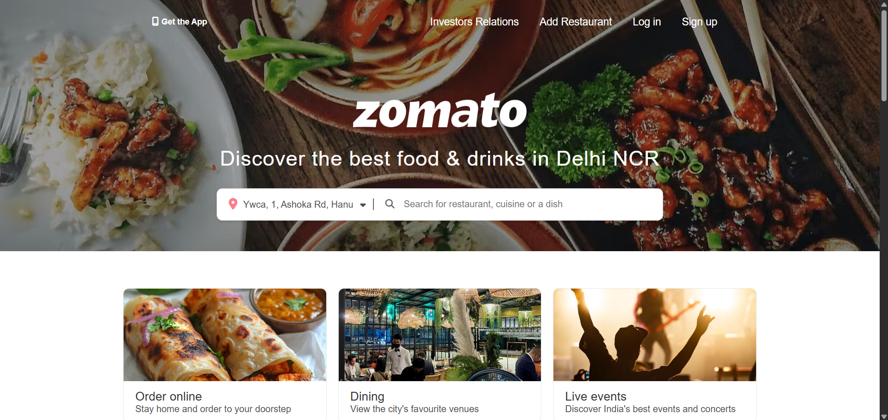
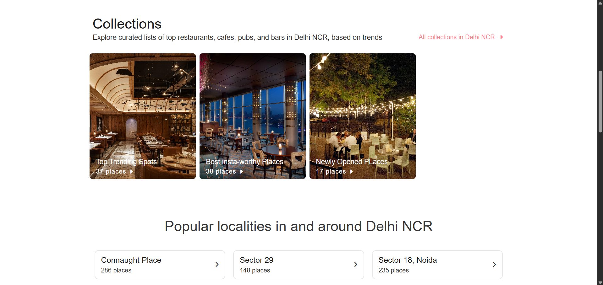
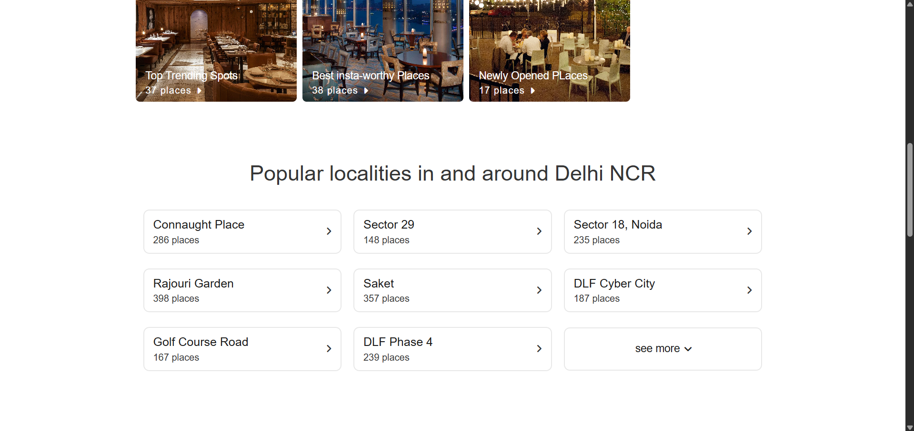
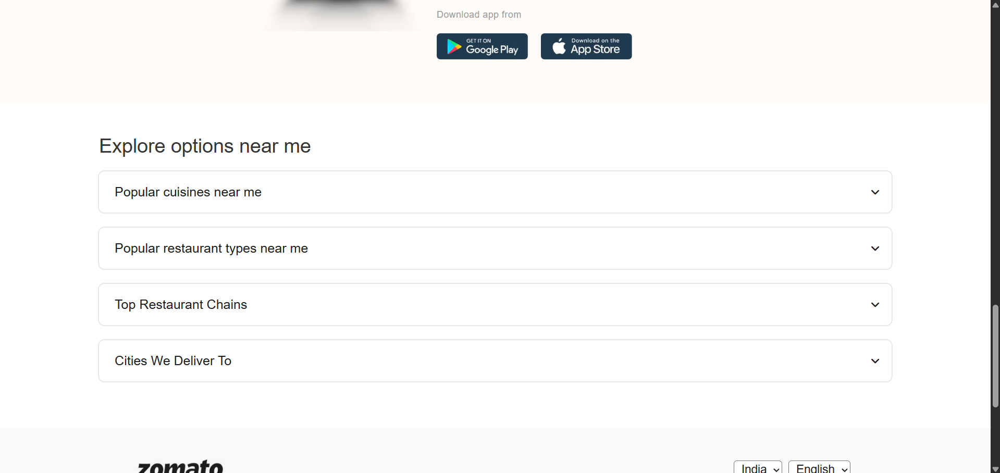
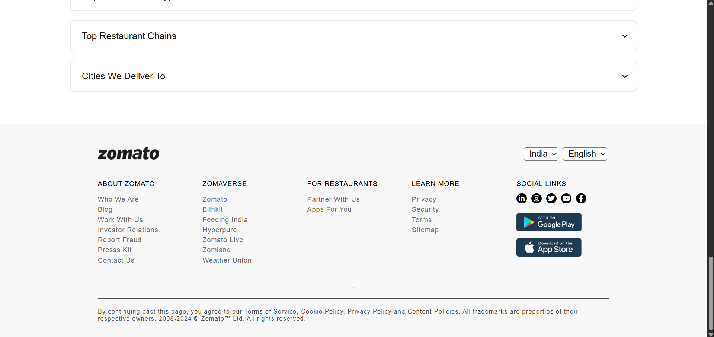
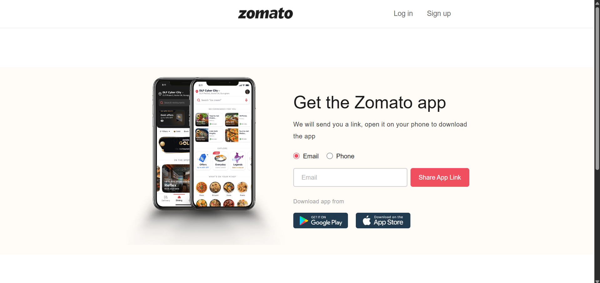

# 🍕 Zomato Website Clone

A **Zomato Website Clone** built using **HTML, CSS, and JavaScript**, enhanced with **Font Awesome icons** for an appealing and interactive design.  

The goal of this project was to replicate the **Zomato homepage UI** while adding interactive features such as search functionality, location-based options, and animated sections.  

✅ **Fully responsive across all screen sizes** — from desktops to tablets and smartphones!  

---

## 📸 Screenshots

| 🏠 Home Section | 📚 Collections Section|
|------------|------------|
|  |  |

| 📍 Localities Section | 🔎 Explore Section |
|------------|------------|
|  |  |

| 🧩 Footer Section | 📱 Get-App Page|
|------------|------------|
|  |  |

---

## 🚀 Features

| Feature | Description |
|:---|:---|
| **Responsive Navbar** | Includes navigation options for logging in, signing up, and adding a restaurant. |
| **Location-Based Search Bar** | Allows users to search for restaurants, cuisines, and dishes. |
| **Interactive Option Boxes** | Provides dedicated sections for online ordering, dining out, and live events. |
| **Collection Section** | Showcases trending spots, Instagram-worthy places, and newly opened restaurants. |
| **Popular Localities** | Highlights well-known food hubs and popular dining destinations across Delhi NCR. |
| **Get the Zomato App Section** | Allows users to enter their phone number or email address to receive the app link. |
| **Smooth Scrolling & Dropdowns** | Uses JavaScript to enable smooth navigation and interactive dropdown menus. |
| **Footer Section** | Includes important navigation links and social media icons. |
| **Fully Responsive Design** | Optimized for seamless viewing across desktop, tablet, and mobile devices. |

---

## 🛠️ Technologies Used

| Technology | Purpose |
|:---|:---|
| **HTML5** | Defines the structure and layout of the website. |
| **CSS3** | Handles styling, responsive layouts, and animations. |
| **JavaScript (Vanilla JS)** | Adds interactivity and manages UI functionality. |
| **Font Awesome** | Provides icons for the navigation bar, search bar, and footer. |

---

## 🎯 How to Run the Project

1️⃣ Clone the repository:
```bash
  git clone https://github.com/TonyStark-19/Zomato-Website-clone.git
```

2️⃣ Open the project folder:
```bash
  cd Zomato-Website-clone
```

3️⃣ Open the `index.html` file in your browser.

---

## 🌟 Acknowledgments

| Source | Contribution |
|:---|:---|
| [**Zomato**](https://www.zomato.com) | Served as the primary inspiration for the website's design, layout, and restaurant discovery experience. |
| **Modern Web Design Practices** | Inspired the use of responsive layouts, clean UI, and user-friendly design principles. |

---

⭐ If you like this project, don’t forget to star the repository!